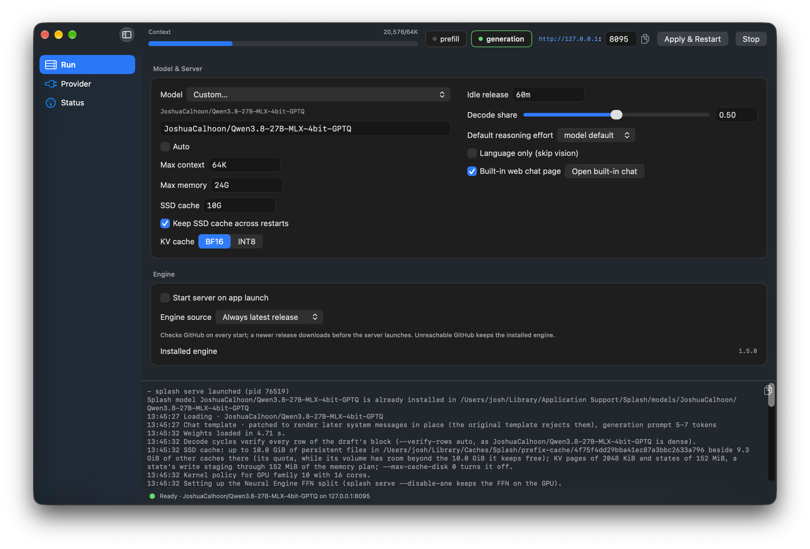
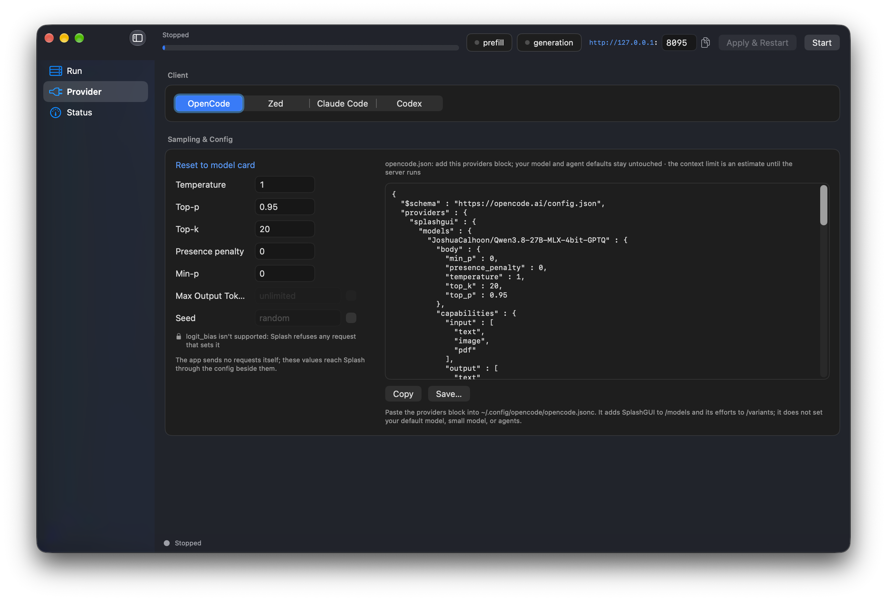
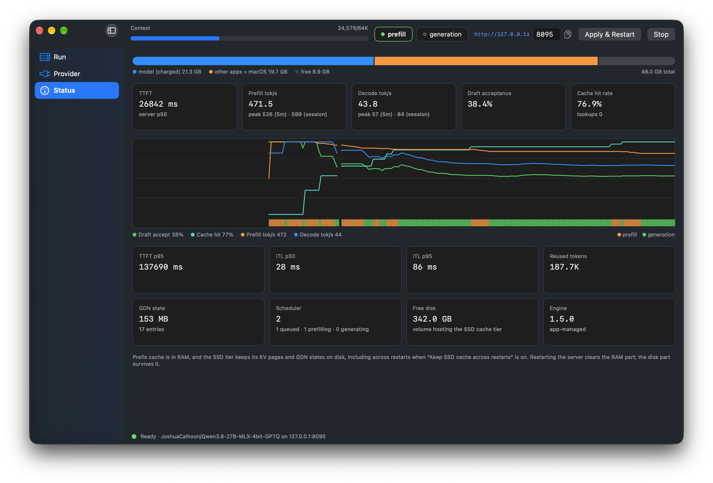

# SplashGUI

A native macOS SwiftUI frontend for the [Splash](https://github.com/incoai/splash) inference engine. Developed because I wasn't aware Splash offered their own desktop app, and I wanted to see stats and specific settings in a layout I liked.

SplashGUI is only a frontend. The engine binary is downloaded from the upstream project at first launch; see [the engine's README](https://github.com/incoai/splash) for how the engine itself works.

## Features
The top bar is always present, and shows engine status (while loading) and context usage (once loaded). It has a prefill/decode block that'll flip green for whichever the model is currently doing, the server URL (and configurable port setting), the apply & restart button, and the start/stop button. There's 3 tabs with additional settings and information:

Run tab: Model picker, settings requiring a restart, default reasoning level, engine version settings. Toggling "Auto" will pick context, memory, SSD cache, and KV Cache quantization based on hardware/Splash engine defaults. Optional toggles to disable the splash web chat server and the vision heads (the latter will save a smidge of VRAM). 


Provider tab: Temperature, top-p/k settings, and other on-the-fly adjustable ones. The json template updates with the settings you pick here and on run, for easy copy-pasting into various service configs (I mostly use OpenCode V2). 


Status tab: monitoring. Shows time to first token, prefill, decode, draft acceptance, cache hit, etc. Graphs prefill tok/s, decode tok/s, cache hit percentage, and draft accept percentage. 

## Requirements

- macOS 26.4 or later
- Apple M3 or later (this is a Splash engine requirement)
- Enough RAM for the model you pick 

## Install

Download the latest `SplashGUI-<version>.dmg` from [Releases](https://github.com/JoshuaCalhoon/SplashGUI/releases), open it, and drag SplashGUI to `/Applications`. It is signed with a Developer ID certificate and notarized, so Gatekeeper opens it without any right-click workaround.

On first launch the app downloads the Splash engine into its application support directory. Model weights are downloaded from Hugging Face when you start a model.

## The model catalogue

The picker ships Splash's own list. Download sizes are the engine's own figures and **include the auto-paired DFlash2 speed draft and vision projector**, the same basis the app's "too large for this Mac" warning uses.

| Model | Download | Smallest Mac | Notes |
| --- | --- | --- | --- |
| Qwen3.6-35B-A3B Q4_K_M (GGUF) | 24 GB | 36 GB | Fast all-rounder |
| Qwen3.6-35B-A3B MLX 4-bit | 21 GB | 36 GB | Fast all-rounder |
| Qwen3.6-35B-A3B Q2_K_XL (GGUF) | 14 GB | 24 GB | Fast all-rounder |
| Qwen3.8-27B Q4_K_M (GGUF) | 21 GB | 36 GB | Strongest at this size, slower |
| Qwen3.8-27B MLX 4-bit | 20 GB | 36 GB | Strongest at this size, slower |
| Qwen3.8-27B IQ3_XXS (GGUF) | 16 GB | 24 GB | Strongest at this size, slower |
| Qwen3.8-Flash-Next Q2_0 (GGUF) | 69 GB | 64 GB | Most capable |
| Flint Q4_K_XL (GGUF) | 26 GB | 48 GB | Text only |
| Ornith-1.5-122B Q4_K_XL (GGUF) | 82 GB | 128 GB | Largest model |
| Ornith-1.5-122B MLX 4-bit | 71 GB | 128 GB | Largest model |
| Ternary-Bonsai 2 27B PQ2_0 | 12 GB | 24 GB | Smallest download |
| Custom… | — | — | Any `owner/repo[:variant]` |

Entries verified on hardware carry an exact Hugging Face revision and file digest (today: IQ3_XXS and Bonsai PQ2_0), so a re-upload under the same name can't silently change what your Mac loads; the rest follow the engine's default resolution.

## Confirmed models for the Custom slot

Outide of Splash's list, these have ran well for me. Paste the ID into **Custom…**:

| Model ID | Notes |
| --- | --- |
| `JoshuaCalhoon/Qwen3.8-27B-MLX-4bit-GPTQ` | My own quant and daily driver, based on sub-agent work in swift, typescript, go, and rust projects. Achieves the same, occasionally slightly better, results in my work as the flat 4-bit MLX quant from mlx-community. |
| `unsloth/Qwen3.8-27B-GGUF:UD-IQ4_XS` | ~19 GB with draft + vision; comfortable on 32 GB+ Macs |
| `unsloth/Qwen3.8-27B-GGUF:UD-Q4_K_XL` | Dynamic 4-bit with 6-bit layers; the quality pick of the GGUF family |

Custom entries are unpinned (no revision/hash pre-flight) — you get whatever the Hub
serves today.

## Using the server

While the server is running it exposes an OpenAI-compatible API at `http://localhost:8095/v1` (port configurable on the Run tab). Any client that speaks that API can point at it. For a quick start without any external tool, the engine also serves a built-in web chat page in the browser ("Built-in web chat page" toggle, on by default).

## Building from source

Requires the Swift 6.2 toolchain (Xcode 26 or the standalone toolchain).

```sh
swift build
scripts/bundle-app.sh --open      # ad-hoc signed build/SplashGUI.app
```

`scripts/bundle-app.sh --release` produces a signed, notarized `SplashGUI-<version>.dmg`.
Set `SIGN_IDENTITY` (a `Developer ID Application` identity) and `NOTARY_PROFILE` (a `notarytool` keychain profile) in the environment first.

## Tests

```sh
scripts/profile-test/run.sh
```

Headless regression for the config store and per-model profiles (drives the real `AppModel`, no GUI). Quit SplashGUI before running it.

## Headless modes

The app binary doubles as a CLI for scripting and CI:

```sh
SplashGUI.app/Contents/MacOS/SplashGUI --install-engine   # install the pinned engine
SplashGUI.app/Contents/MacOS/SplashGUI --auto-profile     # print the derived launch args
SplashGUI.app/Contents/MacOS/SplashGUI --check-model      # verify installed weights' hash
```

## Release

Maintainers only:

```sh
scripts/bundle-app.sh --release
scripts/release.sh                # tags, pushes, and creates the GitHub release
```

## Built with
This is a "vibe coded" project. Built with a combination of Claude Code and OpenCode. OpenCode models used include: DeepSeek V4.1 Flash, GLM 5.3/5.3 flash, a local instance of Qwen 3.8 Flash-Next, and Qwen 3.8-27B running in this app/splash itself, or LMStudio (with the splash engine) before this was working. 

## Contributing

Issues (bugs, feature requests, etc) and pull requests are welcome. Feel free to yell at me if I did something stupid. See [CONTRIBUTING.md](CONTRIBUTING.md) for project info.

## License

[MIT LICENSE](LICENSE). SplashGUI ships no engine code; the Splash engine it manages is licensed separately under Apache-2.0 by its authors.
